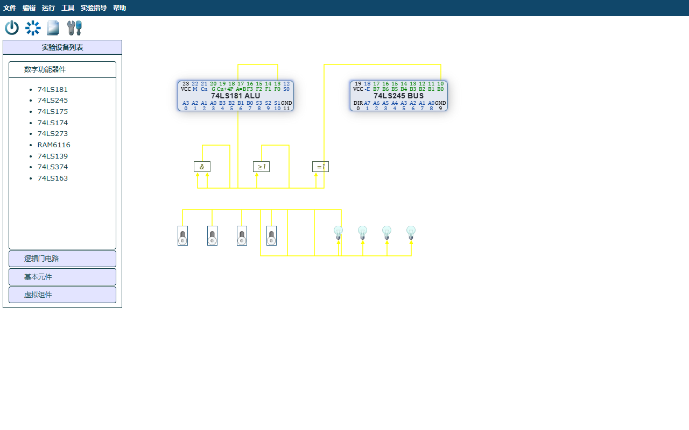
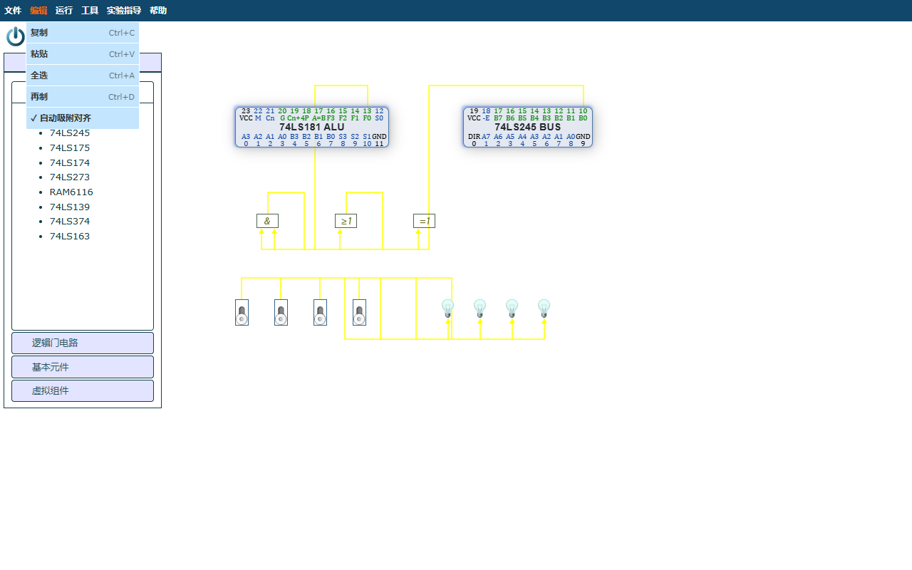

# DS-VLAB 2.0 增强版

> 多思计算机组成原理网络虚拟实验系统（DS-VLAB v2.0）社区增强版
>
> 本项目不是原作者官方仓库，而是在原项目基础上增加编辑功能的社区版本。

**在线体验：** <https://yukk1o.github.io/ds-vlab/>

**GitHub 仓库：** <https://github.com/Yukk1o/ds-vlab>

## 项目简介

DS-VLAB 是一个运行在浏览器中的数字逻辑与计算机组成原理虚拟实验室。它提供 74LS 系列芯片、逻辑门、开关、LED、脉冲源、RAM/EPROM、总线等实验器件，支持搭接电路、保存/打开电路、上电仿真和存储器读写。

原项目：

- 名称：多思计算机组成原理网络虚拟实验系统（DS-VLAB v2.0）
- 作者：张雯雰（ZHANG Wen-fen），湘南学院计算机与人工智能学院
- 版权所有：Copyright (C) 2013 张雯雰
- 许可证：GNU Affero General Public License v3.0 or later（AGPL-3.0-or-later）

本仓库保留原项目的全部著作权声明、源文件头部注释和许可证，仅在此基础上增加编辑体验相关功能。



<details>
<summary>查看“编辑”菜单与快捷键</summary>



</details>

## 新增功能

- **Ctrl+C / Ctrl+V**：复制、粘贴选中的器件，连同选中器件之间的连接线一起复制；粘贴后自动选中新器件。
- **Ctrl+A**：全选画布中的器件。
- **Ctrl+D**：原地再制选中的器件，并自动偏移，避免完全重叠。
- **自动吸附对齐**：拖动器件时，与其它器件的左/中/右、上/中/下边缘自动对齐，并显示红色辅助线。可在“编辑”菜单中关闭，设置会保存在浏览器本地。
- **中键拖动画布**：按住鼠标中键拖动即可平移整个画布；平移后从工具箱拖放器件、框选器件仍然准确。
- **编辑菜单**：新增“复制 / 粘贴 / 全选 / 再制 / 自动吸附对齐”菜单项，菜单中标注对应快捷键。

### 快捷键

| 快捷键 | 功能 |
| --- | --- |
| `Ctrl+C` | 复制选中器件及其内部连接线 |
| `Ctrl+V` | 粘贴剪贴板中的器件（每次粘贴偏移 20px） |
| `Ctrl+A` | 全选器件 |
| `Ctrl+D` | 再制选中器件（偏移 20px） |

macOS 下同时支持 `Command` 键。

### 鼠标操作

| 操作 | 功能 |
| --- | --- |
| 左键拖动空白处 | 框选器件 |
| 左键拖动器件 | 移动器件（可多选后整体移动） |
| 中键拖动 | 平移画布 |
| 右键点击器件/连接线 | 删除器件/连接线 |
| 按住 `Alt` 拖动 | 临时关闭自动吸附对齐 |

> 复制/粘贴使用页面内存中的剪贴板，不会写入操作系统剪贴板；刷新页面后剪贴板内容会清空。

## 运行方式

项目为纯静态页面，无需构建和安装依赖。

### 方式一：直接打开

双击 `index.html`，用 Chrome、Edge 或 Firefox 打开即可。

### 方式二：本地 HTTP 服务（推荐）

在项目目录执行：

```bash
python -m http.server 8000
```

然后访问 <http://localhost:8000/>。

## 目录结构

```text
.
├── index.html              # 主页面
├── css/                    # 样式
├── img/                    # 器件与界面图片
├── js/
│   ├── editorfeatures.js   # 本版本新增：快捷键、吸附对齐、中键平移
│   ├── circuitdiagram.js   # 电路、器件、选择、复制/粘贴核心逻辑
│   ├── makedrag.js         # 器件拖动与吸附
│   ├── toolbox.js          # 实验设备列表与拖放
│   ├── dispatch.js         # 仿真调度
│   ├── fileoperation.js    # 电路保存/打开
│   ├── component/          # 各实验器件实现
│   └── lib/                # jQuery、jQuery UI、取色器
├── files/                  # 实验指导、芯片资料、示例电路
├── docs/                   # README 截图
├── license.txt             # 原始许可证与版权声明
├── LICENSE                 # AGPL-3.0 许可证全文
└── README.md
```

## 本版本修改说明

主要改动：

1. 新增 `js/editorfeatures.js`，实现快捷键、吸附辅助线、菜单开关和中键平移。
2. `js/circuitdiagram.js` 新增复制、粘贴、再制、全选、批量选择等接口；复制时只保留选中器件之间的连接线。
3. `js/makedrag.js` 支持多选整体吸附对齐，并区分左键拖动、右键删除和中键平移。
4. `js/toolbox.js` 修正画布平移后的拖放坐标换算。
5. `index.html` 增加“编辑”菜单、`editorfeatures.js` 引用和 UTF-8 编码声明；`index.html` 与 `js/circuitdiagram.js` 统一为 UTF-8 编码。
6. 新增吸附辅助线、画布平移光标和操作提示样式。

原有功能（芯片仿真、连线、保存/打开、电源/复位、存储器读写、连接线颜色、时钟周期等）保持不变。

## 许可证与著作权

- 原项目及本仓库整体采用 **GNU Affero General Public License v3.0 or later**（AGPL-3.0-or-later）。
- 原项目版权：**Copyright (C) 2013 张雯雰（ZHANG Wen-fen）**，邮箱：<yydzhwf@xnu.edu.cn>，单位：湘南学院计算机与人工智能学院。
- 本版本新增/修改部分：Copyright (C) 2026 DS-VLAB contributors。
- 原始版权声明保留在源文件头部、“关于虚拟实验室”对话框和 `license.txt` 中。
- 许可证全文见 [`LICENSE`](LICENSE) 和 [`license.txt`](license.txt)。

你可以自由复制、修改和再发布本程序，但必须遵守 AGPL-3.0 的条款，包括保留版权声明、提供完整源代码，以及通过网络提供服务时向用户提供对应源代码。

## 致谢

感谢张雯雰老师开发并开源 DS-VLAB，为计算机组成原理实验教学提供了优秀的虚拟实验平台。
